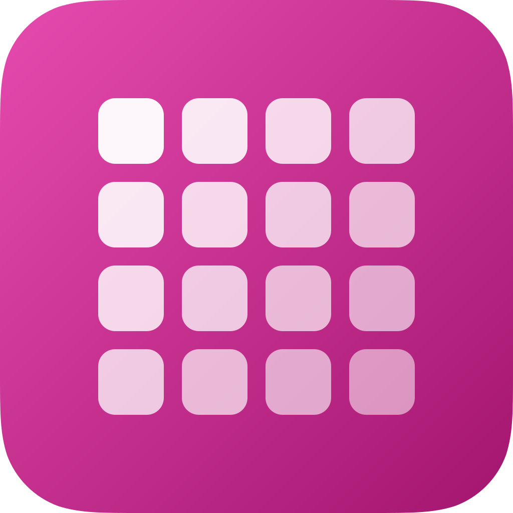

<div align="center">
  
  <h1><b>ryC0</b></h1>
  <p><i>Runs iOS apps inside one app, without installing them.</i></p>
</div>

ryC0 is an iOS app launcher based on [LiveContainer](https://github.com/LiveContainer/LiveContainer) 3.8.11.

## Installing

Requires iOS or iPadOS 17 or later. Sign ryC0 and keep its extensions for multitasking, sharing, and the Launch App shortcut. For JIT-less launch, import the .p12 certificate that signed ryC0 from Settings.

ryC0 uses the bundle ID `com.ry0.ryC0`, the URL scheme `ryc0://`, and the app group `group.com.ry0.ryC0`. The host and LiveProcess use the 128 keychain groups under `com.ry0.ryC0.shared` to separate guest logins. This identity gives ryC0 its own app data and shortcuts.

For general launcher usage, see the [LiveContainer documentation](https://livecontainer.github.io/docs/intro).

## Direct installation API

Open `ryc0://install?url=<percent-encoded IPA URL>` from an iOS app, a shortcut, or a website. Pass the complete download URL as one `url` query item, including any query parameters it needs. HTTPS and HTTP download URLs are supported.

```text
ryc0://install?url=https%3A%2F%2Fexample.com%2FExample.ipa%3Fbuild%3D42%26channel%3Dbeta
```

```swift
import UIKit

@MainActor
func requestRyC0Install(from ipaURL: URL) async -> Bool {
    var link = URLComponents()
    link.scheme = "ryc0"
    link.host = "install"
    link.queryItems = [URLQueryItem(name: "url", value: ipaURL.absoluteString)]
    guard let url = link.url else { return false }
    return await UIApplication.shared.open(url)
}
```

ryC0 downloads the IPA and imports it into its library. If a classic guest is running, ryC0 uses its app-switch setting to return to the Home Screen with the install request. Replacing an existing app still requires confirmation. The return value from `open` reports acceptance of the URL handoff. Download and installation progress and errors appear in ryC0.

## App Switcher

Tap the floating Home button in a regular guest to return to ryC0. Hold it to open the App Switcher. From ryC0's Home Screen, tap the stack icon next to Search. In multitasking, use the window's title menu or the floating controls in a native iPad window.

The switcher can resume or close running windows. Regular guests are relaunched when opened from Recently Opened.

## Building

### Local Nightly releases

Nightly builds run on your Mac. GitHub Actions builds are disabled; GitHub stores
the source code and the resulting IPA releases.

With Xcode, Rust, Node.js, Python 3, and the authenticated GitHub CLI installed:

```sh
node Scripts/nightly.mjs install
```

Every local commit or successful local merge then builds a Nightly, pushes the
committed source to its branch, and uploads the IPA as a GitHub prerelease.
Each release has its own `nightly-<date>-<commit>` tag and build number. After the
uploaded IPA's size and SHA-256 match the local file, older Nightly releases,
their tags, and old local Nightly build folders are removed. Only the latest
published Nightly is retained; stable releases are preserved. Building
uses an isolated checkout of that exact commit, so unsaved or uncommitted work
does not enter the release. The Mac must be running for these local hooks to run.

To retry a failed build or publish the current commit manually:

```sh
node Scripts/nightly.mjs publish
```

IPAs, build logs, and release records are kept under `build/nightly/`. Sign an IPA
with your sideloading tool before installing it. Changes made on GitHub get a
local build when pulled onto this Mac or published with the command above.

### Manual builds

The archive path validator uses Rust. Run `rustup target add aarch64-apple-ios aarch64-apple-ios-sim` for arm64 device and Simulator builds. Intel Simulator and Mac Catalyst builds need their corresponding Rust targets.

With Node.js and Xcode installed on macOS:

```sh
node Scripts/build-manager.mjs build
```

This initializes the submodules, builds the Release app with every extension, and
packages `build/ryC0.ipa`. Sign the IPA with your sideloading tool to install it.
The command also works on Linux with the toolchain below and produces
`build/ryc0/ryC0.ipa`.

On Linux, without Xcode:

```sh
git submodule update --init --recursive
Scripts/ryc0/build.sh
```

This builds `build/ryc0/ryC0.ipa`. [Scripts/ryc0/README.md](Scripts/ryc0/README.md) lists what the build needs and its settings. The Xcode project builds too: set `DEVELOPMENT_TEAM` in `xcconfigs/Global.xcconfig` to your team ID.

`RYC0_SOURCE_URL` in `xcconfigs/Global.xcconfig` sets the source link shown in About. Linux builds can override it with the environment variable of the same name.

The icon is drawn in `Scripts/ryc0/art/AppIcon.svg`. `Scripts/ryc0/art/render-icon.sh` renders it into the asset catalog.

## Source code and license

ryC0 is licensed under the [GNU Affero General Public License v3.0](LICENSE). The source code is available at [Sami-Wali/ryC0](https://github.com/Sami-Wali/ryC0).

This fork includes work from [zContainer](https://github.com/getzeusapp/LiveContainer/tree/zcontainer) and [LiveContainer](https://github.com/LiveContainer/LiveContainer). Their authorship and license notices are preserved.

## How it works

ryC0 runs LiveContainer's runtime as it is. The rest of this section is from LiveContainer's README.

### Project structure
#### Main executable
- Core of LiveContainer
- Contains the logic of setting up guest environment and loading guest app.
- If no app is selected, it loads LiveContainerSwiftUI.

#### LiveContainerSwiftUI
- SwiftUI rewrite of LiveContainerUI (by @hugeBlack)
- Language file `Localizable.xcstrings` is in here for multilingual support. To help us translate LiveContainer, please visit [our crowdin project](https://crowdin.com/project/livecontainer)

#### MultitaskSupport
- Contains the implementation of multitasking feature.
- Based on [FrontBoardAppLauncher](https://github.com/khanhduytran0/FrontBoardAppLauncher)

#### TweakLoader
- A simple tweak injector, which loads CydiaSubstrate and loads tweaks.
- Injected to every app you install in LiveContainer.

#### ZSign
- The app signer shipped with LiveContainer.
- Originally made by [zhlynn](https://github.com/zhlynn/zsign).
- LiveContainer uses [Feather's](https://github.com/khcrysalis/Feather) version of ZSign modified by khcrysalis.
- Changes are made to meet LiveContainer's needs.

### How guest apps run

#### Patching guest executable
- Patch `__PAGEZERO` segment:
  + Change `vmaddr` to `0xFFFFC000` (`0x100000000 - 0x4000`)
  + Change `vmsize` to `0x4000`
- Change `MH_EXECUTE` to `MH_DYLIB`.
- Inject a load command to load `TweakLoader.dylib`

#### Patching `@executable_path`
- Hook `dyld4::APIs::_NSGetExecutablePath`
- Call `_NSGetExecutablePath`
- Replace `config.process.mainExecutablePath`
  - Calculate address of `config.process.mainExecutablePath` using `dyld4::APIs` instance (passed as first parameter)
  - Use `builtin_vm_protect` or TPRO unlock to make it writable
  - Replace the address with one we have control of
- Put the original `dyld4::APIs::_NSGetExecutablePath` back

> Old Method
>- Call `_NSGetExecutablePath` with an invalid buffer pointer input -> SIGSEGV
>- Do some [magic stuff](https://github.com/khanhduytran0/LiveContainer/blob/5ef1e6a/main.m#L74-L115) to overwrite the contents of executable_path.

#### Patching `NSBundle.mainBundle`
- This property is overwritten with the guest app's bundle.

#### Bypassing Library Validation
- JIT is optional to bypass codesigning. In JIT-less mode, all executables are signed so this does not apply.
- Derived from [Restoring Dyld Memory Loading](https://blog.xpnsec.com/restoring-dyld-memory-loading)

#### dlopening the executable
- Call `dlopen` with the guest app's executable
- TweakLoader loads all tweaks in the selected folder
- Find the entry point
- Jump to the entry point
- The guest app's entry point calls `UIApplicationMain` and start up like any other iOS apps.

#### Multi-Account support & Keychain Semi-Separation
[128 keychain access groups](./entitlements.xml) are created and LiveContainer allocates them randomly to each container of the same app. So you can create 128 container with different keychain access groups.

### Limitations
- Entitlements from the guest app are not applied to the host app. This isn't a big deal since sideloaded apps requires only basic entitlements.
- App Permissions are globally applied.
- Guest app containers are not sandboxed. This means one guest app can access other guest apps' data.
- App extensions aren't supported. they cannot be registered because: LiveContainer is sandboxed, SpringBoard doesn't know what apps are installed in LiveContainer, and they take up App ID.
- Multitasking can be achieved by using multiple LiveContainer and the multitasking feature. However, while we were able to fix physical keyboard input issue on iPadOS (https://github.com/LiveContainer/LiveContainer/issues/524), iPhone Mirroring uses different checks which still broke it (https://github.com/LiveContainer/LiveContainer/issues/793).
- Remote push notification will not work
- Querying custom URL schemes might not work(?)

## Credits

ryC0 exists because of LiveContainer, made by [Duy Tran (khanhduytran0)](https://github.com/khanhduytran0), [Huge_Black (hugeBlack)](https://github.com/hugeBlack) and [its contributors](https://github.com/LiveContainer/LiveContainer/graphs/contributors).

LiveContainer's credits:
- [xpn's blogpost: Restoring Dyld Memory Loading](https://blog.xpnsec.com/restoring-dyld-memory-loading)
- [LinusHenze's CFastFind](https://github.com/pinauten/PatchfinderUtils/blob/master/Sources/CFastFind/CFastFind.c): [MIT license](https://github.com/pinauten/PatchfinderUtils/blob/master/LICENSE)
- [litehook](https://github.com/opa334/litehook): [MIT license](https://github.com/opa334/litehook/blob/main/LICENSE)
- @haxi0 & @m1337v for LiveContainer's icon
- @Vishram1123 for the initial shortcut implementation.
- @hugeBlack for SwiftUI contribution
- @Staubgeborener for automatic AltStore/SideStore source updater
- @fkunn1326 for improved app hiding
- @slds1 for dynamic color feature
- @Vishram1123 for iOS 26+ JIT Script Support
- @StephenDev0 for AltStore source support

ryC0 also ships the following. The app carries the text of each license (Settings > About ryC0 > Licenses, from each project's `LICENSE` file or from `Resources/Licenses`).
- [OpenSSL](https://www.openssl.org): [Apache License 2.0](https://www.openssl.org/source/license.html)
- [ElleKit](https://github.com/evelyneee/ellekit)'s CydiaSubstrate, by Évelyne Bélanger: BSD license (its `LICENSE` is in `Resources/Frameworks/CydiaSubstrate.framework`)
- [zsign](https://github.com/zhlynn/zsign) by zhlynn (BSD 3-Clause License when LiveContainer took it, MIT since 2025), in [Feather](https://github.com/khcrysalis/Feather)'s version by khcrysalis (GPL 3.0)
